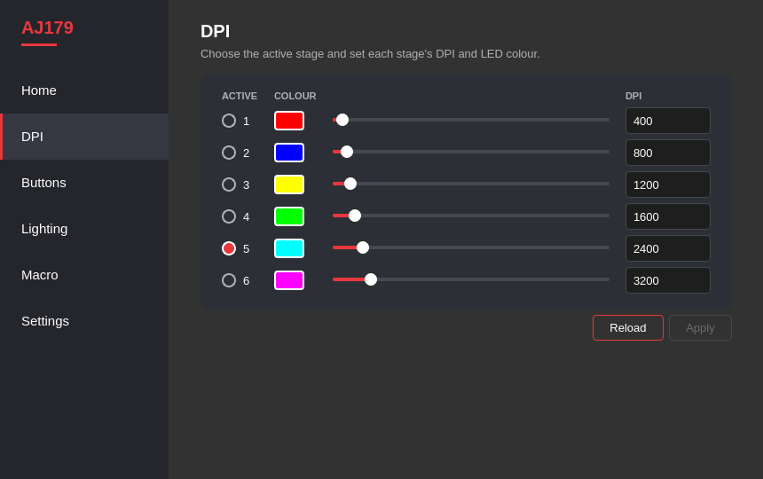

# aj179-linux

Linux support for the **Ajazz AJ179** (dual mode) mouse. The official Ajazz software
only runs on Windows; this project gives you three things on Linux:

* **`ajazz_daemon`**: a background service that puts the mouse's battery level in your
  status bar (Waybar, Polybar, Eww, ...).
* **`ajazzctl`**: a command-line tool for every setting of the official driver: DPI,
  report rate, lighting, lift-off distance, Motion Sync, Angle Snap, power options,
  button mapping and macros.
* **The AJ179 app**: a desktop window for all of the above, styled after the official
  driver.

All of them work over the 2.4 GHz receiver and over the USB cable.

---

## Contents
* [Supported hardware](#supported-hardware)
* [Installation](#installation)
* [Desktop app](#desktop-app)
* [Battery in your status bar](#battery-in-your-status-bar)
* [Mouse settings: ajazzctl](#mouse-settings-ajazzctl)
* [How it works](#how-it-works)
* [Troubleshooting](#troubleshooting)
* [Development](#development)

---

## Supported hardware

| Connection | USB ID | `lsusb` shows |
|---|---|---|
| 2.4 GHz receiver | `249a:5c2f` | XCTECH Wireless-Receiver |
| USB cable | `248a:5c2e` | Maxxter AJAZZ AJ179 Mouse |

Tested on the AJ179 dual mode with the PAW3395 sensor (the model the official
"AJ179 / AJ179P dual mode" driver is for). To check yours:

```bash
lsusb | grep -iE '249a:5c2f|248a:5c2e'
```

Other Ajazz models speak different protocols and are not supported. Bluetooth is not
supported either (the official driver cannot configure the mouse over Bluetooth).

---

## Installation

### One command
```bash
curl -fsSL https://raw.githubusercontent.com/Rockeyxx/aj179-linux/main/install.sh | sudo bash
```
This installs everything: the battery service, `ajazzctl` and the AJ179 app, along with
what they need (gcc, make, PyQt6) through pacman, apt or dnf. Run it again to update.

Prefer one file? Download [`install.sh`](install.sh) and run `sudo bash install.sh`; it
fetches the rest. For another Ajazz mouse, give its receiver IDs:
`sudo VENDOR_ID=xxxx PRODUCT_ID=xxxx bash install.sh`.

### Arch Linux (AUR)
```bash
yay -S aj179-linux-git   # formerly aj179-linux-battery-git
```

### From a clone
```bash
git clone https://github.com/Rockeyxx/aj179-linux.git
cd aj179-linux
sudo ./install.sh
```

### Manual
Install `gcc` and `make`, and PyQt6 for the app (Arch: `sudo pacman -S gcc make
python-pyqt6`, Debian/Ubuntu: `sudo apt install gcc make python3-pyqt6`), then:
```bash
make
sudo make install
sudo udevadm control --reload && sudo udevadm trigger
sudo systemctl enable --now ajazz-mouse.service
```

### What gets installed

| File | Purpose |
|---|---|
| `/usr/bin/ajazz_daemon` | battery service |
| `/usr/bin/ajazzctl` | settings tool (`man ajazzctl`) |
| `/usr/bin/aj179` | the desktop app (also in your launcher as **AJ179**) |
| `/usr/share/aj179-linux/gui/` | the app's files |
| `/etc/systemd/system/ajazz-mouse.service` | starts the daemon at boot |
| `/etc/udev/rules.d/70-ajazz.rules` | lets the logged-in user use the mouse without `sudo` |
| `/etc/conf.d/ajazz-battery` | receiver USB IDs for the daemon (defaults are right for the AJ179) |

To remove everything: `sudo ./uninstall.sh`, or without a clone:
`curl -fsSL https://raw.githubusercontent.com/Rockeyxx/aj179-linux/main/uninstall.sh | sudo bash`.

---

## Desktop app



A window for the battery, DPI stages, report rate and sensor options, lighting, buttons
and macros, laid out like the official driver. It is installed with everything else
(see [Installation](#installation)): open **AJ179** from your application launcher, or
run `aj179`. It makes every change through `ajazzctl`.

* The battery page reads the battery service's file, so the service must be running.
* The mouse cannot report its buttons or macros; those pages show what was last set
  from Linux.
* Over the receiver the mouse must be awake; a page waiting for it says so. Move the
  mouse and it carries on.

---

## Battery in your status bar

The daemon keeps one line of JSON in `/tmp/ajazz_battery`:

```json
{"text": "🖱️ 95%", "tooltip": "Ajazz Mouse", "class": "mouse"}
```

| `class` | Meaning |
|---|---|
| `mouse` | running on battery |
| `charging` | USB cable plugged in; the text shows ⚡ |
| `disconnected` | neither the receiver nor the cable is plugged in; the text shows `...` |

The level appears as soon as the daemon starts. While the mouse sleeps, the last level
stays on screen.

### Waybar
Add `"custom/ajazz"` to `modules-left` or `modules-right` in `~/.config/waybar/config`,
then add the module:

```json
"custom/ajazz": {
    "exec": "cat /tmp/ajazz_battery",
    "return-type": "json",
    "interval": 5,
    "tooltip": true
}
```

Optional styling in `~/.config/waybar/style.css`:

```css
#custom-ajazz.charging     { color: #a6e3a1; }
#custom-ajazz.disconnected { opacity: 0.5; }
```

Polybar, Eww and others can read the same file; the `text` field is what to display.

---

## Mouse settings: ajazzctl

`ajazzctl` runs as your normal user. Every change is stored in the mouse itself, so it
stays after a reboot, and each change is read back from the mouse to confirm it. The full
reference is in `man ajazzctl`.

```text
$ ajazzctl show
report rate:  1000 Hz
dpi stages:   400 800 1200 1600 *2400 3200
dpi colours:  #ff0000 #0000ff #ffff00 #00ff00 #00ffff #ff00ff
lighting:     constant, brightness 4, speed 0
lift-off:     high (2 mm)
motion sync:  off
angle snap:   off
power (raw):  sleep 30, wake-on-move 0, lights-off-on-move 0, debounce 8
receiver fw:  41.01

$ ajazzctl dpi 2 1600
ok (verified by read-back)
```

| Command | What it does |
|---|---|
| `ajazzctl info` | link (cable or receiver), device id, battery |
| `ajazzctl show` | all current settings |
| `ajazzctl rate 1000` | report rate: 125, 250, 500 or 1000 Hz |
| `ajazzctl dpi 2 1600` | DPI of stage 2 (stages 1–6; 50–26000 in steps of 50) |
| `ajazzctl dpi select 2` | make stage 2 the active one |
| `ajazzctl dpi-colour 2 '#00ff00'` | LED colour of stage 2 |
| `ajazzctl lighting off` | lights off |
| `ajazzctl lighting breathing 4 2` | breathing; brightness and speed 0–4 |
| `ajazzctl lighting constant '#00ffff' 4 0` | one colour |
| `ajazzctl sensor lod 1` | lift-off distance: 1 = 1 mm, 2 = 2 mm |
| `ajazzctl sensor motion-sync on` | Motion Sync on/off |
| `ajazzctl sensor angle-snap off` | Angle Snap on/off |
| `ajazzctl power wake-on-move on` | wake the mouse by moving it |
| `ajazzctl power lights-off-on-move on` | turn the lights off while moving |
| `ajazzctl power sleep 30` | sleep time, raw value (factory 30) |
| `ajazzctl power debounce 8` | button debounce, raw value (factory 8) |
| `ajazzctl button 4 key:ctrl+c` | remap a button |
| `ajazzctl buttons reset` | factory button mapping |
| `ajazzctl macro 5 ctrl+a wait:50 ctrl+c` | put a macro on a button |

**The mouse has to be awake.** Over the receiver, settings only reach the mouse while it
is in use. If `ajazzctl` prints `mouse is asleep - move it`, move the mouse; it waits and
then continues. Over the cable the mouse is always awake.

### Buttons
Buttons are numbered **1** left, **2** right, **3** middle, **4** back (rear side
button), **5** forward (front side button), **6** DPI. Button 1 cannot be remapped, so
you can always click your way back. A button can become:

* another mouse button: `left`, `right`, `middle`, `back`, `forward`
* a wheel step: `scroll-up`, `scroll-down`
* `dpi-loop` (cycle through the DPI stages, what button 6 does from the factory)
* a media key: `play-pause`, `stop`, `previous`, `next`, `volume-up`, `volume-down`, `mute`
* a keyboard key with modifiers: `key:ctrl+c`, `key:super+tab`, `key:f5`, `key:enter`

The mouse cannot report its button mapping, so `ajazzctl` remembers what it last wrote
in `~/.config/ajazzctl/buttons`. If you changed buttons another way, run
`ajazzctl buttons reset` first.

### Macros
`ajazzctl macro <button> <keys...>` stores a key sequence and makes the button play it
once per press. Each key is pressed and released in order; `wait:N` adds a pause of N
milliseconds after the previous key:

```bash
ajazzctl macro 5 ctrl+a wait:50 ctrl+c     # select all, then copy
ajazzctl macro 4 h e l l o enter           # type "hello" and press Enter
```

---

## How it works

* The receiver and the cable each expose a vendor interface (USB interface 2). Both
  programs use it through the kernel's `/dev/hidrawN` node, so the kernel driver stays
  attached and the USB device is never reset.
* The daemon asks for the battery level when it starts, then listens for the reports
  the mouse sends on its own. On the cable it re-reads the level every 30 seconds, and it
  switches between cable and receiver when you plug or unplug.
* The protocol was decompiled from the official **AJAZZ Driver (X) 1.0.7.0** and checked
  on the mouse. [docs/PROTOCOL.md](docs/PROTOCOL.md) lists every command, where in the
  official driver it comes from, and what was confirmed on hardware.
* Only commands taken from the official driver are ever sent. Firmware updates are not
  implemented.

---

## Troubleshooting

| Problem | What to do |
|---|---|
| `AJ179 not found` | Check `lsusb` (see [Supported hardware](#supported-hardware)). |
| `Permission denied` on `/dev/hidraw*` | Run `sudo udevadm control --reload && sudo udevadm trigger`, or unplug and replug the receiver. |
| `mouse is asleep - move it` | Move the mouse; `ajazzctl` continues by itself. |
| Status bar shows `...` | Check `systemctl status ajazz-mouse` and `journalctl -u ajazz-mouse`. |
| A button does something unexpected | `ajazzctl buttons reset` |

---

## Development

```text
src/        daemon, ajazzctl, protocol and hidraw code
tests/      unit tests (make test)
packaging/  systemd unit, udev rule, config
docs/       PROTOCOL.md, ajazzctl man page
gui/        the desktop app (PyQt6) and its tests
```

`make` builds both programs and `make test` runs the tests.

To work on the app without installing it, use [uv](https://docs.astral.sh/uv/), which
fetches PyQt6 into `gui/.venv`: `uv run --project gui gui/ajazz_gui.py` runs it and
`uv run --project gui pytest gui/tests` runs its tests. `gui/install-desktop-entry.sh`
adds a launcher entry for this clone, which takes the place of the installed one. Pull requests are welcome;
please run `make test` first. If you have another Ajazz model, an issue with the output
of `lsusb` and `ajazzctl info` is a good start.

---

**Not affiliated with Ajazz.** · **Developer:** [Rockeyxx](https://github.com/Rockeyxx) ·
**License:** MIT
